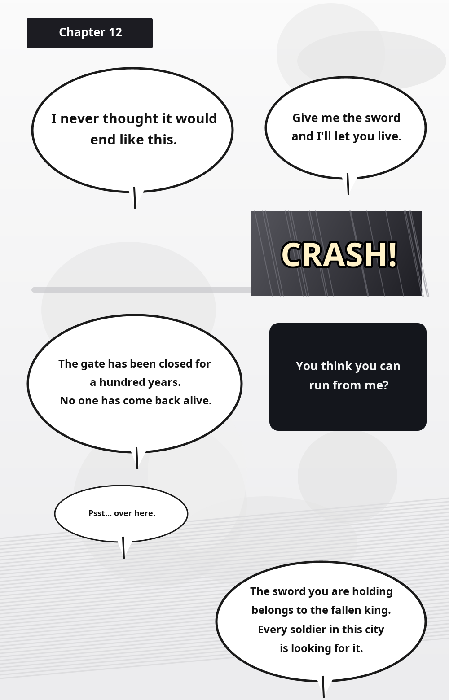

<p align="center">
  
  
</p>

<h1 align="center">Manhwa Translate</h1>

<p align="center">
  Dịch truyện tranh Hàn – Nhật – Trung sang tiếng Việt <b>ngay trên điện thoại</b>.<br/>
  Nhận diện chữ → xoá chữ gốc → dịch → vẽ lại bản dịch vào đúng bong bóng.
</p>

<p align="center">
  
  
  
  
</p>

---

## Giới thiệu

Manhwa Translate là ứng dụng Android mã nguồn mở. Bạn mở một trang truyện và ứng dụng tự động
hoàn thành toàn bộ quy trình dịch — không cần chụp màn hình, không cần gửi ảnh đi đâu.

| Bước | Mô tả |
| --- | --- |
|  | Nhận diện vùng chữ bằng ML Kit (Hàn, Nhật, Trung, Latinh) hoặc PaddleOCR qua server. |
|  | Xoá chữ gốc bằng inpaint riêng, giữ nguyên nền, vân và gradient của bong bóng. |
|  | Dịch với bộ nguồn miễn phí tích hợp sẵn hoặc provider nâng cao có API key. |
|  | Vẽ bản dịch khớp cỡ chữ, kiểu chữ và bong bóng gốc, có viền và bóng đổ. |

## Tính năng

| | |
| --- | --- |
| **Nhận diện thông minh** | Tự chọn mô hình phù hợp, bắt cả chữ nhỏ trên ảnh nén. |
| **Chữ nghiêng** | Tự đo độ nghiêng của từng dòng chữ, đọc lại theo đúng góc đó và vẽ bản dịch theo cùng chiều. |
| **Inpaint giữ nền gốc** | Vá màu sát vân giấy, gradient và độ dốc của bong bóng; chỉ vá đúng màu mực nên hình trang trí trong khung chữ vẫn còn. |
| **Dịch linh hoạt** | Miễn phí không cần key, hoặc dùng Google Cloud, DeepL, Gemini, OpenAI. |
| **AI offline** | Chạy model GGUF (llama.cpp) ngay trên máy, không cần mạng. |
| **Trình đọc webtoon** | Đọc web, chặn quảng cáo, tự dịch ảnh ngay khi trang tải xong và dò tiếp ảnh mới khi cuộn. |
| **Tuỳ chỉnh** | Nhập font riêng, chỉnh cỡ chữ, kiểu chữ, màu và bóng. |

## Cài đặt

Tải APK từ **Releases** — chọn `app-arm64-v8a-debug.apk` cho hầu hết điện thoại.

## Build từ mã nguồn

Yêu cầu: **JDK 17+**, **Android SDK 35**.

```bash
export ANDROID_HOME=$HOME/android-sdk
echo "sdk.dir=$ANDROID_HOME" > local.properties

./gradlew :app:assembleDebug   # APK: app/build/outputs/apk/debug/
./gradlew :core:test           # unit test thuật toán
./gradlew :demo:run            # chạy pipeline trên trang mẫu
```

## Kiến trúc

```
core/   Thuật toán thuần JVM (không phụ thuộc Android): inpaint, layout, ghép vùng, pipeline
app/    Android: OCR, các provider dịch, Compose UI, trình đọc web, chặn quảng cáo
demo/   Harness Java2D chạy pipeline trên trang mẫu, xuất ảnh PNG để kiểm tra
```

Toàn bộ phần khó (mask, inpaint, layout, ghép vùng) nằm trong module JVM thuần nên chạy được
unit test và trên desktop.
