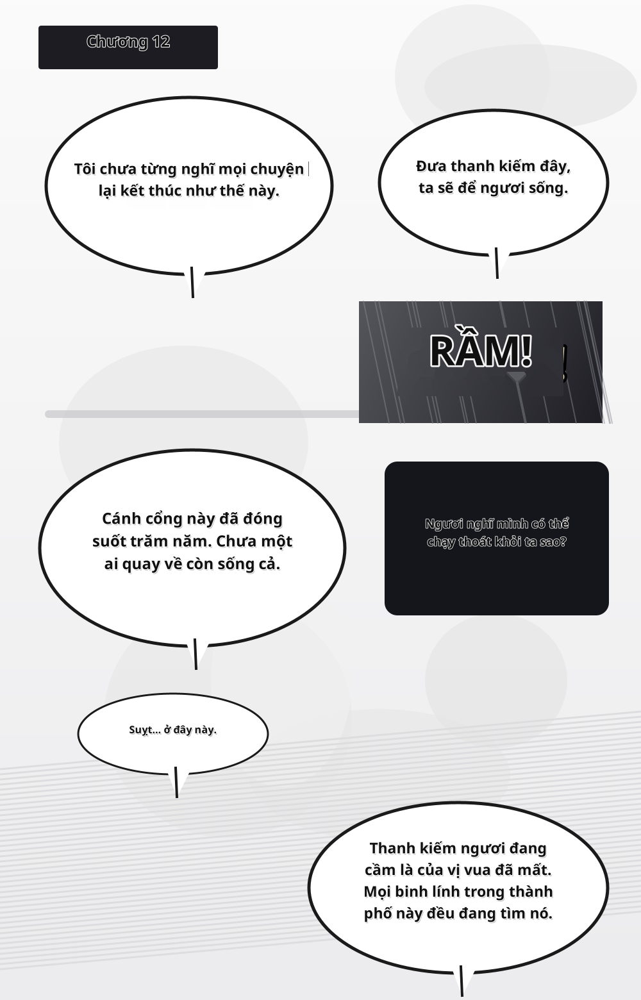

# Manhwa Translate

Ứng dụng Android (Kotlin + Jetpack Compose) dịch truyện tranh Hàn – Nhật – Trung sang tiếng Việt
ngay trên máy: **nhận diện vùng chữ → xoá chữ gốc → dịch → vẽ bản dịch vào đúng bong bóng**.

<p align="center">
  
  
</p>

## Tính năng

- **Nhận diện chữ** bằng ML Kit (Latinh, Hàn, Trung, Nhật). Chế độ *Tự động* chạy cả bốn mô
  hình rồi chọn kết quả hợp lý nhất cho từng bong bóng.
- **Xoá chữ gốc** bằng thuật toán inpaint riêng: dựng mask theo màu nền bong bóng và tương phản
  cục bộ, đóng hình thái để lấp nét đứt, rồi tô nền (bong bóng phẳng) hoặc lan màu (nền có
  gradient, hiệu ứng) tuỳ vùng.
- **Dịch** qua 5 nhà cung cấp: ML Kit trên máy (miễn phí, offline), Google Cloud Translation,
  DeepL, Gemini, và mọi endpoint kiểu OpenAI (OpenAI, DeepSeek, Groq, OpenRouter, server nội bộ).
  Nhà cung cấp kiểu LLM dịch cả trang trong một lượt để giữ ngữ cảnh, có đánh số `[[n]]` để ghép
  lại chính xác.
- **Vẽ bản dịch**: chữ tự co giãn để vừa khung chữ gốc, tự xuống dòng theo từ (hoặc theo từng ký
  tự với tiếng Trung/Nhật), tự chọn màu chữ sáng/tối theo nền bong bóng, có viền và bóng đổ.
- **Ảnh webtoon dài**: trang được cắt thành các dải chồng lấn để OCR, sau đó ghép lại và khử trùng
  lặp vùng chữ ở mép dải.
- **Sửa bản dịch**: chạm vào khung chữ để sửa tay hoặc dịch lại riêng vùng đó; mọi thay đổi được
  vẽ lại và lưu.
- **Chia sẻ / lưu ảnh**: nhận ảnh từ ứng dụng khác qua menu Chia sẻ, xuất PNG vào thư viện ảnh.

## Kiến trúc

```
core/   Kotlin/JVM thuần, không phụ thuộc Android — toàn bộ thuật toán
  geometry/   RectI
  image/      ArgbImage, Colors
  scan/       ImageTiler (cắt dải), RegionMerger (khử trùng lặp, nối đoạn bị cắt)
  erase/      TextMaskBuilder (mask theo nền + tương phản), Morphology, TextEraser (solid/diffusion)
  layout/     TextLayoutEngine (tự co cỡ chữ, ngắt dòng theo từ và CJK)
  render/     RenderStyle, PageCompositor (interface vẽ theo nền tảng)
  translate/  TranslationProvider, TranslationService (chia lô, khử trùng, retry)
  pipeline/   TranslationPipeline (detect → erase → translate → render)
app/    Android: ML Kit OCR, các provider dịch, Canvas renderer, Compose UI, DataStore
demo/   Harness Java2D chạy đúng pipeline trên một trang manhwa tổng hợp, xuất ảnh PNG để kiểm tra
```

Toàn bộ phần khó (mask, inpaint, layout, ghép vùng) nằm trong module JVM thuần nên chạy được
unit test và chạy được trên desktop. Module `demo` dùng chính `TextLayoutEngine`,
`TextMaskBuilder`, `TextEraser` của app để dựng ảnh minh chứng.

## Build

Yêu cầu: JDK 17+, Android SDK 35.

```bash
export ANDROID_HOME=$HOME/android-sdk
echo "sdk.dir=$ANDROID_HOME" > local.properties
./gradlew :app:assembleDebug      # APK: app/build/outputs/apk/debug/app-debug.apk
./gradlew :core:test              # unit test thuật toán
./gradlew :demo:run               # chạy pipeline trên trang mẫu, ghi ảnh vào ./out
```

`assembleDebug` tạo APK riêng cho từng kiến trúc CPU (`app-arm64-v8a-debug.apk` ~50 MB dùng cho
hầu hết điện thoại) và một APK universal (~100 MB). CI trên GitHub cũng build và đính kèm APK.

## Cài đặt

1. Mở APK, cấp quyền lưu ảnh nếu máy chạy Android 9 trở xuống.
2. Vào **Cài đặt → Nhà cung cấp dịch**. Mặc định là ML Kit trên máy: miễn phí, chỉ cần mạng
   lần đầu để tải gói ngôn ngữ (~30 MB). Muốn chất lượng cao hơn thì nhập API key Google Cloud,
   DeepL, Gemini hoặc OpenAI.
3. Chọn **Chữ trên ảnh** (Hàn/Nhật/Trung/Latinh) nếu truyện chỉ có một ngôn ngữ — nhận diện sẽ
   nhanh hơn nhiều so với chế độ Tự động.
4. Về trang chủ, chọn ảnh hoặc chụp ảnh. Ứng dụng xử lý rồi mở trình xem.

## Đo chất lượng xoá chữ

`demo` xuất ảnh trước/sau khi xoá. Trên trang mẫu (bong bóng trắng, bong bóng đen, khung caption
đen, chữ hiệu ứng trên nền gradient):

| Vùng | Mực chữ trước | Mực chữ sau khi xoá | Nền sau khi xoá (độ lệch chuẩn) |
| --- | --- | --- | --- |
| Bong bóng thoại 1 | 11.8% | 0.0% | 0.5 |
| Bong bóng thoại 2 | 13.7% | 0.0% | 0.0 |
| Bong bóng nền đen (chữ sáng) | 11.2% | 0.0% | 0.0 |
| Chữ hiệu ứng nền gradient | 14.0% | 0.0% | giữ gradient |

## Giới hạn đã biết

- ML Kit không có bounding box theo từng ký tự; vùng nhận diện là theo dòng/khối. Bong bóng có
  chữ xoay nghiêng hoặc chữ lồng trong hình vẽ phức tạp có thể bị xoá lem.
- ML Kit không dịch tốt văn phong truyện; nên dùng provider LLM nếu cần chất lượng.
- Bản dịch dài hơn nhiều so với gốc sẽ thu nhỏ cỡ chữ; tăng "Mở rộng khung chữ" trong Cài đặt.
- Chưa hỗ trợ chữ dọc (manga Nhật) — hiện vẽ ngang.
